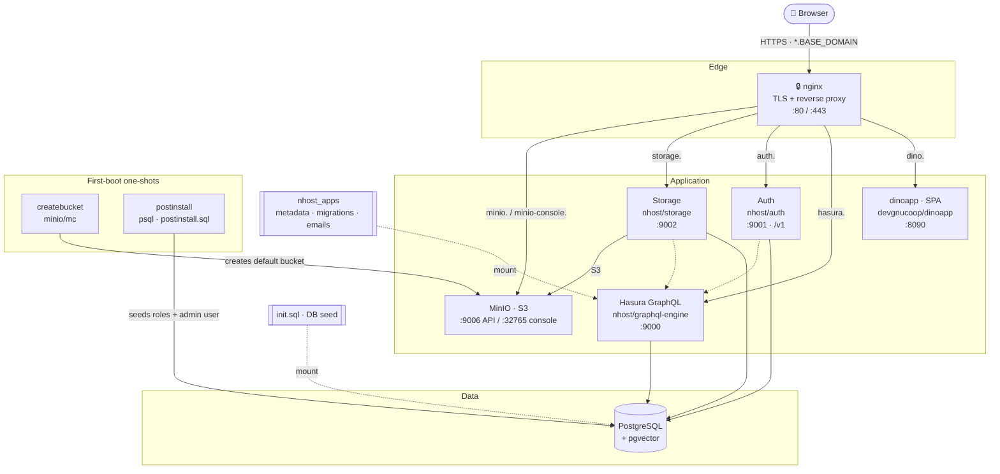

# ⚡ The 30-Second Dino Installer

A slim, one-command setup for the Dino backend stack. Instead of hand-editing
`.env`, `nginx.conf` and TLS certs (and keeping their domains in sync), you run
`setup.sh` once: it asks for a single **base domain**, auto-generates every
secret, and renders a consistent configuration ready for `docker compose up -d`.

## Quick start

```bash
# 1. Clone
git clone git@github.com:gnucoop/dino-install.git
cd dino-install

# 2. Generate a deployment into a folder of your choice, and answer the prompts
./setup.sh my-dino

# 3. Start the stack
cd my-dino
docker compose up -d          # or: docker-compose up -d

# 4. Open the app in your browser at the Dino URL
#    https://dino.<BASE_DOMAIN>
#    (the exact URL + admin email/password are printed at the end of setup.sh)
```

> See [Requirements](#requirements) first. For `selfsigned` TLS you need
> **mkcert**, and the subdomains must resolve (`setup.sh` offers to add the
> `/etc/hosts` entries for you).

## Stack

Services: **nginx** (TLS termination + reverse proxy), **dinoapp** (the Dino SPA,
served from the `devgnucoop/dinoapp` image), **PostgreSQL** (pgvector),
**Hasura GraphQL**, **nhost Auth**, **MinIO** (S3-compatible storage) and
**nhost Storage**. Two short-lived helpers run on first boot: `createbucket`
(creates the default MinIO bucket) and `postinstall` (seeds initial data once the
schema exists — see below).



**Request flow:** the browser hits `https://<service>.<BASE_DOMAIN>`; nginx
terminates TLS and reverse-proxies each subdomain to the right service. Hasura,
Auth and Storage all talk to Postgres; Storage keeps objects in MinIO; Hasura
applies the `nhost_apps` migrations/metadata; Postgres is seeded from `init.sql`.
On first boot `createbucket` creates the default bucket and `postinstall` seeds
the roles + admin login, then both exit.

### First-boot seed (`postinstall.sql`)

After Hasura and Auth have applied their migrations, the `postinstall` service
seeds initial data **once** (idempotent — it only runs when the tables are empty):

- the four roles: `admin`, `supervisor`, `collector`, `guest`
- an `Admin` user group (full permissions)
- a **web login user** in `auth.users` whose email/password are the
  `ADMIN_EMAIL` / `ADMIN_PASSWORD` from setup, display name `USER_DISPLAY_NAME`
- that user's `admin` + `user` role mapping and a linked `user_data` row
- an anonymous `user_data` row

So after `docker compose up -d` you can log into the SPA at `https://dino.<domain>`
with the admin email + password shown at the end of `setup.sh`.

> Pandino (AI backend), the chatbot proxy and the welcome site are intentionally
> excluded from this slim kit.

## Requirements

### Software (required)

`setup.sh` checks all of these up front and aborts with a clear message if any
are missing:

| Tool | Purpose |
|------|---------|
| **Docker** (daemon running) | runs the stack |
| **Docker Compose** | `docker compose` plugin *or* legacy `docker-compose` |
| **openssl** | generates secrets and self-signed certificates |
| **git** | clones `nhost_apps` |
| **bash** (3.2+) / **sed** | run and render the installer |

### Software (TLS-mode dependent)

| Tool | When | Purpose |
|------|------|---------|
| **mkcert** | **required** for `selfsigned` | installs a local CA so browsers trust the certs. `setup.sh` **aborts** in `selfsigned` mode if it is missing — a plain openssl self-signed cert is untrusted and breaks cross-origin auth/GraphQL/WebSocket, so there is no fallback. |
| **certbot** | recommended for `letsencrypt` | auto-issues **Let's Encrypt** certs. If absent, the script prints the exact command to run. |

### Access & network

- **git access to the `nhost_apps` repo** (Hasura metadata / migrations / emails).
  `setup.sh` clones it into a real `nhost_apps/` folder — the installer never
  depends on any file outside itself. Default is SSH
  (`git@github.com:gnucoop/nhost_apps.git`, branch `prod-1.21.0-permissions-m2`);
  override with `SETUP_NHOST_APPS_REPO` / `SETUP_NHOST_APPS_BRANCH`.
- **Free host ports:** `80`, `443` (nginx), `5432` (postgres), `8090` (SPA),
  `9000`/`9001`/`9002` (hasura/auth/storage), `9006`/`32765` (MinIO API/console).
  `setup.sh` verifies all of these are free and **aborts** (listing the offenders)
  if any are in use — bypass with `SETUP_SKIP_PORT_CHECK=1`.
- **Name resolution** for the six subdomains (see the table below):
  - local install → `setup.sh` prints the `/etc/hosts` lines and can append them;
  - public install → real DNS A/AAAA records pointing at the host.

### Backend image

- The SPA ships as the **`devgnucoop/dinoapp`** image (no Node/Angular build
  needed here). If you build your own image, its `environment.ts` **must** define
  `dataConfig.socketJwtExpiredCode` (e.g. `4403`) — otherwise the app hangs on
  "Initializing data…". Set `DINOAPP_VERSION` in `.env` to pick the tag.

### Bundled (nothing to fetch)

`init.sql` (DB seed) and `postinstall.sql` (first-boot data) ship committed in
this folder and are copied into each deployment automatically.

## Usage

```bash
./setup.sh                 # generate in place
./setup.sh ../my-dino      # generate a ready-to-run deployment in ../my-dino
docker compose up -d       # (run from the folder setup.sh wrote to)
```

`setup.sh [TARGET_DIR]` writes `.env`, `nginx.conf`, TLS `certs/`, a copy of
`docker-compose.yml`, copies `init.sql` + `postinstall.sql`, and clones
`nhost_apps/` into `TARGET_DIR` (default: this folder). This lets you keep the
installer as read-only source and
materialize each deployment into its own directory.

You'll be asked for a base domain (e.g. `local.dinoapp.cloud` or
`dino.example.com`), an admin email/password (blank = auto-generated), and a
TLS mode. All service hostnames are derived from the base domain:

| Service      | Hostname                          |
|--------------|-----------------------------------|
| App (SPA)    | `dino.<BASE_DOMAIN>`              |
| Auth         | `auth.<BASE_DOMAIN>`             |
| Hasura       | `hasura.<BASE_DOMAIN>`          |
| Storage      | `storage.<BASE_DOMAIN>`        |
| MinIO API    | `minio.<BASE_DOMAIN>`          |
| MinIO console| `minio-console.<BASE_DOMAIN>` |

### TLS modes

- **selfsigned** — generates a locally-trusted wildcard cert via **mkcert**
  (required; no browser warnings). The script prints the `/etc/hosts` lines you
  need and can append them for you.
- **letsencrypt** — runs `certbot` if installed (needs public DNS + port 80),
  otherwise prints the exact command.
- **provided** — bring your own `certs/fullchain.pem` + `certs/privkey.pem`.

### Unattended / cloud install

Every prompt has a `SETUP_<NAME>` override; set `SETUP_NONINTERACTIVE=1` to skip
prompting entirely:

```bash
SETUP_NONINTERACTIVE=1 \
SETUP_BASE_DOMAIN=dino.example.com \
SETUP_ADMIN_EMAIL=admin@example.com \
SETUP_TLS_MODE=letsencrypt \
./setup.sh
```

## Safety guards

Before writing anything, `setup.sh`:

- **Refuses to overwrite an existing deployment** — if the target folder already
  contains a `docker-compose.yml` (or, for an in-place run, a generated `.env`),
  it aborts rather than regenerate secrets and break a running stack. Override
  with `SETUP_FORCE=1`.
- **Checks all required host ports are free** and aborts listing any in use.
  Override with `SETUP_SKIP_PORT_CHECK=1`.

## What gets generated

`.env`, `nginx.conf`, `certs/` and a cloned `nhost_apps/` — all git-ignored.
Re-running `setup.sh` backs up any existing `.env` to `.env.backup`.

## Updating an existing deployment

> **Which folder?** Everything above happens in *this* folder — the installer
> source. Everything below happens in your **deployment folder**: the
> `TARGET_DIR` you passed to `setup.sh` (e.g. `my-dino/`), the one that holds the
> generated `.env`, `nginx.conf`, `certs/`, `nhost_apps/`, `data/` and
> `minio/storage/`. Do **not** re-run `setup.sh` to update — it would regenerate
> every secret and break the running stack (which is exactly why the
> existing-deployment guard aborts).

```bash
cd my-dino                      # your deployment folder, NOT the installer

# 0. Back up first
docker compose down
cp -a ../my-dino ../my-dino.backup-$(date +%F)

# 1. Pull DB updates (Hasura metadata + migrations)
git -C nhost_apps pull

# 2. Bump the image tags you want in .env
#    DINOAPP_VERSION=...  (and HASURA_VERSION, HASURA_AUTH_VERSION,
#    HASURA_STORAGE_VERSION, POSTGRES_VERSION, MINIO_VERSION, NGINX_VERSION)

# 3. Fetch the new images and restart
docker compose pull
docker compose up -d
```

### 0. Back up your deployment folder

All state lives inside the folder — Postgres in `./data`, MinIO objects in
`./minio/storage`, and your unrecoverable secrets in `.env`. Copying the whole
folder (with the stack stopped, so Postgres is consistent) is a complete backup
and the only rollback you get.

### 1. Pull `nhost_apps` for database updates

New Hasura migrations and metadata arrive through the `nhost_apps/` clone:

```bash
git -C nhost_apps pull
```

The Hasura image is the `cli-migrations` variant, so it applies any new
migrations and reloads metadata automatically on startup — there is nothing to
run by hand. `postinstall.sql` is idempotent and will no-op on an existing
install, so your seeded roles and admin user are left alone.

> If the clone was made shallow (`--depth 1`) and `git pull` complains, use
> `git -C nhost_apps fetch --depth 1 origin <branch> && git -C nhost_apps reset --hard FETCH_HEAD`.

### 2. Bump the app versions in `.env`

Edit the deployment's `.env` and set the new tag(s). `DINOAPP_VERSION` is the
usual one; the same applies to any other component you're moving:

| Variable | Component |
|---|---|
| `DINOAPP_VERSION` | Dino SPA (`devgnucoop/dinoapp`) |
| `HASURA_VERSION` | Hasura GraphQL engine |
| `HASURA_AUTH_VERSION` | nhost Auth |
| `HASURA_STORAGE_VERSION` | nhost Storage |
| `POSTGRES_VERSION` | Postgres / pgvector |
| `MINIO_VERSION` / `MC_VERSION` | MinIO + client |
| `NGINX_VERSION` | edge nginx |

Change tags only — leave the generated secrets, domains and ports untouched.
Bumping `POSTGRES_VERSION` across a major release is a data migration, not a
restart: dump first.

### 3. Restart the stack

```bash
docker compose down
docker compose pull            # required if a tag is 'latest' or already cached
docker compose up -d
docker compose logs -f graphql # watch the migrations apply
```

`docker compose pull` matters: with a floating tag like `latest`, `up -d` reuses
the image already on disk and your "update" silently does nothing. Never pass
`-v` to `down` — the stack uses bind mounts, but the habit is what destroys data
elsewhere.
