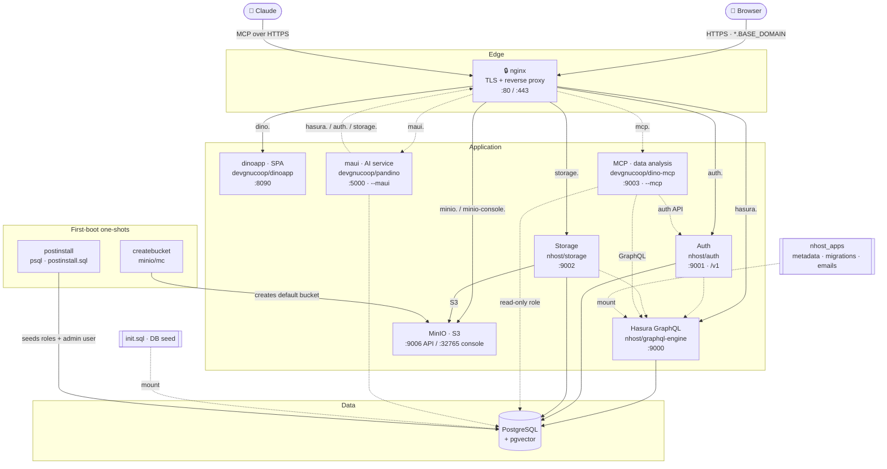

# ⚡ The 30-Second Dino Installer

A slim, one-command setup for the Dino backend stack. Instead of hand-editing
`.env`, `nginx.conf` and TLS certs (and keeping their domains in sync), you run
`setup.sh` once: it asks for a single **base domain**, auto-generates every
secret, and renders a consistent configuration ready for `docker compose up -d`.

## Quick start

```bash
# 1. Clone
git clone git@github.com:gnucoop/dino-install.git
cd dino-install

# 2. Generate a deployment into a folder of your choice, and answer the prompts
./setup.sh my-dino            # add --mcp and/or --maui for the optional components

# 3. Start the stack
cd my-dino
docker compose up -d          # or: docker-compose up -d

# 4. Open the app in your browser at the Dino URL
#    https://dino.<BASE_DOMAIN>
#    (the exact URL + admin email/password are printed at the end of setup.sh)
```

> See [Requirements](#requirements) first. For `selfsigned` TLS you need
> **mkcert**, and the subdomains must resolve (`setup.sh` offers to add the
> `/etc/hosts` entries for you).

## Stack

Services: **nginx** (TLS termination + reverse proxy), **dinoapp** (the Dino SPA,
served from the `devgnucoop/dinoapp` image), **PostgreSQL** (pgvector),
**Hasura GraphQL**, **nhost Auth**, **MinIO** (S3-compatible storage) and
**nhost Storage**. Two short-lived helpers run on first boot: `createbucket`
(creates the default MinIO bucket) and `postinstall` (seeds initial data once the
schema exists — see below).

Two **optional components** are added only when you ask for them (see
[Optional components](#optional-components---mcp---maui)):
**mcp** (`--mcp`, a read-only MCP server that lets Claude analyse the collected
data) and **maui** (`--maui`, the pandino AI service). They are drawn dashed below.



**Request flow:** the browser hits `https://<service>.<BASE_DOMAIN>`; nginx
terminates TLS and reverse-proxies each subdomain to the right service. Hasura,
Auth and Storage all talk to Postgres; Storage keeps objects in MinIO; Hasura
applies the `nhost_apps` migrations/metadata; Postgres is seeded from `init.sql`.
On first boot `createbucket` creates the default bucket and `postinstall` seeds
the roles + admin login, then both exit. When enabled, the `mcp` service reads
Postgres through its own least-privilege role and never writes; `maui` uses
Postgres directly and reaches Hasura/Auth/Storage through nginx by their public
names.

### First-boot seed (`postinstall.sql`)

After Hasura and Auth have applied their migrations, the `postinstall` service
seeds initial data **once** (idempotent — it only runs when the tables are empty):

- the four roles: `admin`, `supervisor`, `collector`, `guest`
- an `Admin` user group (full permissions)
- a **web login user** in `auth.users` whose email/password are the
  `ADMIN_EMAIL` / `ADMIN_PASSWORD` from setup, display name `USER_DISPLAY_NAME`
- that user's `admin` + `user` role mapping and a linked `user_data` row
- an anonymous `user_data` row

So after `docker compose up -d` you can log into the SPA at `https://dino.<domain>`
with the admin email + password shown at the end of `setup.sh`.

> The chatbot proxy and the welcome site are intentionally excluded from this
> slim kit. Pandino (the AI backend) is available as the optional `maui`
> component (`./setup.sh --maui`).

## Requirements

### Software (required)

`setup.sh` checks all of these up front and aborts with a clear message if any
are missing:

| Tool | Purpose |
|------|---------|
| **Docker** (daemon running) | runs the stack |
| **Docker Compose** | `docker compose` plugin *or* legacy `docker-compose` |
| **openssl** | generates secrets and self-signed certificates |
| **git** | clones `nhost_apps` |
| **bash** (3.2+) / **sed** | run and render the installer |
| **htpasswd** (`--maui` only) | bcrypt-hashes the maui admin password. If it is not installed, `setup.sh` runs it from the `httpd:2-alpine` image instead. |

### Software (TLS-mode dependent)

| Tool | When | Purpose |
|------|------|---------|
| **mkcert** | **required** for `selfsigned` | installs a local CA so browsers trust the certs. `setup.sh` **aborts** in `selfsigned` mode if it is missing — a plain openssl self-signed cert is untrusted and breaks cross-origin auth/GraphQL/WebSocket, so there is no fallback. |
| **certbot** | recommended for `letsencrypt` | auto-issues **Let's Encrypt** certs. If absent, the script prints the exact command to run. |

### Access & network

- **git access to the `nhost_apps` repo** (Hasura metadata / migrations / emails).
  `setup.sh` clones it into a real `nhost_apps/` folder — the installer never
  depends on any file outside itself. Default is
  `https://github.com/gnucoop/dino-db-config`, branch `main`; override with
  `SETUP_NHOST_APPS_REPO` / `SETUP_NHOST_APPS_BRANCH`.
- **Free host ports:** `80`, `443` (nginx), `5432` (postgres), `8090` (SPA),
  `9000`/`9001`/`9002` (hasura/auth/storage), `9006`/`32765` (MinIO API/console),
  plus `9003` with `--mcp` and `5000` with `--maui`.
  `setup.sh` verifies all of these are free and **aborts** (listing the offenders)
  if any are in use — bypass with `SETUP_SKIP_PORT_CHECK=1`.
- **Name resolution** for the six subdomains, plus `mcp.` / `maui.` when those
  components are enabled (see the table below):
  - local install → `setup.sh` prints the `/etc/hosts` lines and can append them;
  - public install → real DNS A/AAAA records pointing at the host.

### Backend image

- The SPA ships as the **`devgnucoop/dinoapp`** image (no Node/Angular build
  needed here). If you build your own image, its `environment.ts` **must** define
  `dataConfig.socketJwtExpiredCode` (e.g. `4403`) — otherwise the app hangs on
  "Initializing data…". Set `DINOAPP_VERSION` in `.env` to pick the tag.

### Bundled (nothing to fetch)

`init.sql` (DB seed) and `postinstall.sql` (first-boot data) ship committed in
this folder and are copied into each deployment automatically.

## Usage

```bash
./setup.sh                        # generate in place
./setup.sh ../my-dino             # generate a ready-to-run deployment in ../my-dino
./setup.sh --mcp --maui ../my-dino  # ...with both optional components
docker compose up -d              # (run from the folder setup.sh wrote to)
```

`setup.sh [--mcp] [--maui] [TARGET_DIR]` writes `.env`, `nginx.conf`, TLS
`certs/`, a copy of `docker-compose.yml` (plus the overlay file of each enabled
component), copies `init.sql` + `postinstall.sql`, and clones
`nhost_apps/` into `TARGET_DIR` (default: this folder). This lets you keep the
installer as read-only source and
materialize each deployment into its own directory.

You'll be asked for a base domain (e.g. `local.dinoapp.cloud` or
`dino.example.com`), an admin email/password (blank = auto-generated), and a
TLS mode. All service hostnames are derived from the base domain:

| Service      | Hostname                          |
|--------------|-----------------------------------|
| App (SPA)    | `dino.<BASE_DOMAIN>`              |
| Auth         | `auth.<BASE_DOMAIN>`             |
| Hasura       | `hasura.<BASE_DOMAIN>`          |
| Storage      | `storage.<BASE_DOMAIN>`        |
| MinIO API    | `minio.<BASE_DOMAIN>`          |
| MinIO console| `minio-console.<BASE_DOMAIN>` |
| MCP (Claude) | `mcp.<BASE_DOMAIN>` — `--mcp` only   |
| maui         | `maui.<BASE_DOMAIN>` — `--maui` only |

### TLS modes

- **selfsigned** — generates a locally-trusted wildcard cert via **mkcert**
  (required; no browser warnings). The script prints the `/etc/hosts` lines you
  need and can append them for you.
- **letsencrypt** — runs `certbot` if installed (needs public DNS + port 80),
  otherwise prints the exact command.
- **provided** — bring your own `certs/fullchain.pem` + `certs/privkey.pem`.

### Unattended / cloud install

Every prompt has a `SETUP_<NAME>` override; set `SETUP_NONINTERACTIVE=1` to skip
prompting entirely:

```bash
SETUP_NONINTERACTIVE=1 \
SETUP_BASE_DOMAIN=dino.example.com \
SETUP_ADMIN_EMAIL=admin@example.com \
SETUP_TLS_MODE=letsencrypt \
./setup.sh
```

Use `SETUP_MCP=1` / `SETUP_MAUI=1` in place of the `--mcp` / `--maui` flags. The
maui inputs are `SETUP_MAUI_ADMIN_USERNAME`, `SETUP_MAUI_ADMIN_PASSWORD` (blank =
auto-generated), `SETUP_STRIPE_SK_KEY`, `SETUP_DEEPINFRA_API_KEY` and
`SETUP_MISTRAL_API_KEY`.

## Optional components (`--mcp`, `--maui`)

Without flags, `setup.sh` installs the default stack only. Each flag adds one
component, and they can be combined:

| Flag | Service | Files it brings in |
|---|---|---|
| `--mcp`  | `mcp` (dino-mcp, Claude connector) | `docker-compose.mcp.yml`, `.env.mcp.template`, the `@mcp` blocks of `nginx.conf.template` |
| `--maui` | `maui` (pandino AI service) | `docker-compose.maui.yml`, `.env.maui.template`, the `@maui` blocks of `nginx.conf.template` |

For each enabled component, `setup.sh` appends its block to `.env`, keeps its
`# @<name>-begin … # @<name>-end` server and upstream blocks in `nginx.conf`
(disabled ones are removed), adds its subdomain to the certificate and
`/etc/hosts` lists, and checks its host port. The generated `.env` ends with a
`COMPOSE_FILE=` line listing the compose files to load, so a plain
`docker compose up -d` starts exactly the chosen set of services.

### maui

`--maui` prompts for the maui admin username and password, and stores the
password as a bcrypt `ADMIN_PASSWORD_HASH`. It also prompts for the Stripe,
DeepInfra and Mistral API keys (blank allowed) and generates `MAUI_ENCRYPTION_KEY`.
The model and provider settings (`DATACHAT_*`, `PROMPT_*`, `COMPLETION_*`,
`VISION_*`, `AUDIO_*`, `WHISPER_MODEL`, `MAUI_SCHEMA`, the token costs,
`OLLAMA_BASE_URL`) are left empty in the `# --- MAUI ---` block of `.env`: fill
them in before the first `docker compose up -d`. maui keeps its runtime data in
`./cache`, `./exports` and `./logs` in the deployment folder.

## Connecting Claude (the `mcp` service, `--mcp`)

The `mcp` service exposes this deployment's collected data to Claude — claude.ai,
Claude Desktop or Claude Code — **read-only**, and scoped by the caller's own
Dino permissions rather than by Hasura's. Every request runs *as a Dino user*:
there is no MCP account and no service account, and the answer Claude gets is
exactly the slice of the dataset that user sees in the app.

Mint a personal access token for a Dino user, then add the connector:

```bash
docker compose exec mcp dino-mcp token create --email you@example.org --expires 90d
claude mcp add --transport http dino https://mcp.<BASE_DOMAIN>/mcp \
  --header "Authorization: Bearer dino_pat_..."
```

The token is shown once. `dino-mcp token list` and `dino-mcp token revoke <id>`
manage the rest. Granting or revoking access is done in Dino itself: a user's
groups decide what they can read, and disabling or deleting the user blocks MCP
on the next call.

> **A shared token is a shared identity.** A single token configured for a whole
> Claude organisation collapses every member onto one Dino principal, which
> silently defeats group and metric scoping. That is acceptable only for a
> single-analyst deployment or a test. Per-member sign-in (OAuth), which
> claude.ai custom connectors require, is the next milestone of `dino-mcp`.

### Two settings that must match the SPA build

| Variable | Must match |
|---|---|
| `MCP_ADMIN_ROLES` | `environment.usersConfig.adminRoles` |
| `MCP_ACTIVE_METRICS` | `environment.optionalModulesConfig` (the active metric modules) |

If they disagree, MCP answers disagree with what the app shows: a metric module
that the SPA does not use contributes no scoping clause at all.

### Where it is deliberately stricter than the app

Dino's application-level permission checks fail *open* in two places, because in
the SPA they are UI conveniences with Hasura's row-level permissions still
standing behind them. In MCP there is nothing behind them, so both are inverted:

- a user with **no groups** reads **nothing** (the app would allow everything);
- a role that says nothing about a subject grants **nothing** for that role (the
  app would allow it, and skip the remaining roles).

Kept as the app has it, including where it widens access: a record with **no
metric reference** (no project, no location…) stays visible to everyone, an
**empty** metric array means "only records with no metric", and a user in several
groups gets the flat union of them.

### Turning it off

Install without `--mcp`. On an existing deployment, run `docker compose stop mcp`,
remove `:docker-compose.mcp.yml` from the `COMPOSE_FILE` line in `.env`, and drop
the `mcp.` server block and `upstream mcp` from `nginx.conf`. Set
`MCP_CREATE_INDEXES=false` beforehand if you do not want the service to add the
missing `form_data` indexes to your schema.

## Safety guards

Before writing anything, `setup.sh`:

- **Refuses to overwrite an existing deployment** — if the target folder already
  contains a `docker-compose.yml` (or, for an in-place run, a generated `.env`),
  it aborts rather than regenerate secrets and break a running stack. Override
  with `SETUP_FORCE=1`.
- **Checks all required host ports are free** and aborts listing any in use.
  Override with `SETUP_SKIP_PORT_CHECK=1`.

## What gets generated

`.env`, `nginx.conf`, `certs/` and a cloned `nhost_apps/` — all git-ignored.
With `--maui`, also the empty `cache/`, `exports/` and `logs/` folders.
Re-running `setup.sh` backs up any existing `.env` to `.env.backup`.

## Updating an existing deployment

> **Which folder?** Everything above happens in *this* folder — the installer
> source. Everything below happens in your **deployment folder**: the
> `TARGET_DIR` you passed to `setup.sh` (e.g. `my-dino/`), the one that holds the
> generated `.env`, `nginx.conf`, `certs/`, `nhost_apps/`, `data/` and
> `minio/storage/`. Do **not** re-run `setup.sh` to update — it would regenerate
> every secret and break the running stack (which is exactly why the
> existing-deployment guard aborts).

```bash
cd my-dino                      # your deployment folder, NOT the installer

# 0. Back up first
docker compose down
cp -a ../my-dino ../my-dino.backup-$(date +%F)

# 1. Pull DB updates (Hasura metadata + migrations)
git -C nhost_apps pull

# 2. Bump the image tags you want in .env
#    DINOAPP_VERSION=...  (and HASURA_VERSION, HASURA_AUTH_VERSION,
#    HASURA_STORAGE_VERSION, POSTGRES_VERSION, MINIO_VERSION, NGINX_VERSION,
#    MCP_VERSION, MAUI_VERSION)

# 3. Fetch the new images and restart
docker compose pull
docker compose up -d
```

### Adding an optional component to an existing deployment

Both components are purely additive — no existing service changes — so an
existing deployment picks one up without touching its data volume. For `<c>` =
`mcp` or `maui`:

1. copy `docker-compose.<c>.yml` from this folder into the deployment folder;
2. append `.env.<c>.template` to the deployment's `.env`, replacing
   `__BASE_DOMAIN__` with your domain and filling in the other `__…__` tokens:
   - mcp: `openssl rand -hex 32` for `MCP_ENCRYPTION_KEY`,
     `openssl rand -hex 16` for `MCP_DB_PASSWORD`;
   - maui: `openssl rand -hex 32` for `MAUI_ENCRYPTION_KEY`; the admin username;
     `htpasswd -nbBC 12 "" 'password' | tr -d ':\n'` for `ADMIN_PASSWORD_HASH`
     (keep the single quotes); the API keys; then the model settings;
3. add `:docker-compose.<c>.yml` to the `COMPOSE_FILE=` line in `.env`. A
   deployment generated before this change has no such line, so add both
   `COMPOSE_PATH_SEPARATOR=:` and `COMPOSE_FILE=docker-compose.yml:docker-compose.<c>.yml`.
   Also add `BASE_DOMAIN=<your domain>` if `.env` lacks it (maui needs it);
4. copy the `# @<c>-begin … # @<c>-end` server block **and** upstream block from
   `nginx.conf.template` into your `nginx.conf`, substituting your domain,
   upstream host and port (`9003` for mcp, `5000` for maui). For mcp,
   `proxy_buffering off` is the line that breaks streaming silently if it is
   missed;
5. issue a certificate covering `<c>.<BASE_DOMAIN>` (certbot: add
   `-d <c>.<BASE_DOMAIN>`), and for a local install add it to `/etc/hosts`;
6. for maui, run `mkdir -p cache exports logs`;
7. `docker compose up -d <c> && docker compose restart nginx`.

The mcp container creates its own read-only role and schema on boot; it never
migrates Dino's own tables, and only adds indexes to `form_data` when
`MCP_CREATE_INDEXES=true`.

### 0. Back up your deployment folder

All state lives inside the folder — Postgres in `./data`, MinIO objects in
`./minio/storage`, and your unrecoverable secrets in `.env`. Copying the whole
folder (with the stack stopped, so Postgres is consistent) is a complete backup
and the only rollback you get.

### 1. Pull `nhost_apps` for database updates

New Hasura migrations and metadata arrive through the `nhost_apps/` clone:

```bash
git -C nhost_apps pull
```

The Hasura image is the `cli-migrations` variant, so it applies any new
migrations and reloads metadata automatically on startup — there is nothing to
run by hand. `postinstall.sql` is idempotent and will no-op on an existing
install, so your seeded roles and admin user are left alone.

> If the clone was made shallow (`--depth 1`) and `git pull` complains, use
> `git -C nhost_apps fetch --depth 1 origin <branch> && git -C nhost_apps reset --hard FETCH_HEAD`.

### 2. Bump the app versions in `.env`

Edit the deployment's `.env` and set the new tag(s). `DINOAPP_VERSION` is the
usual one; the same applies to any other component you're moving:

| Variable | Component |
|---|---|
| `DINOAPP_VERSION` | Dino SPA (`devgnucoop/dinoapp`) |
| `HASURA_VERSION` | Hasura GraphQL engine |
| `HASURA_AUTH_VERSION` | nhost Auth |
| `HASURA_STORAGE_VERSION` | nhost Storage |
| `POSTGRES_VERSION` | Postgres / pgvector |
| `MINIO_VERSION` / `MC_VERSION` | MinIO + client |
| `NGINX_VERSION` | edge nginx |
| `MCP_VERSION` | dino-mcp (`--mcp`) |
| `MAUI_VERSION` | maui / pandino (`--maui`) |

Change tags only — leave the generated secrets, domains and ports untouched.
Bumping `POSTGRES_VERSION` across a major release is a data migration, not a
restart: dump first.

### 3. Restart the stack

```bash
docker compose down
docker compose pull            # required if a tag is 'latest' or already cached
docker compose up -d
docker compose logs -f graphql # watch the migrations apply
```

`docker compose pull` matters: with a floating tag like `latest`, `up -d` reuses
the image already on disk and your "update" silently does nothing. Never pass
`-v` to `down` — the stack uses bind mounts, but the habit is what destroys data
elsewhere.
